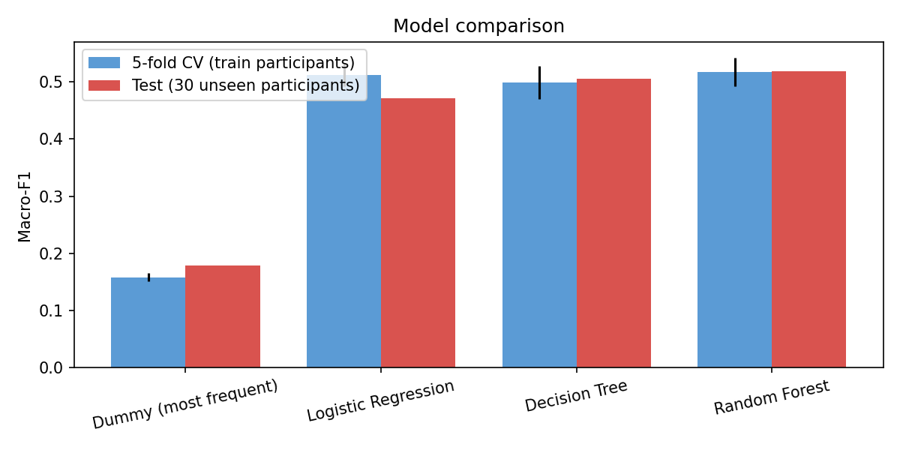
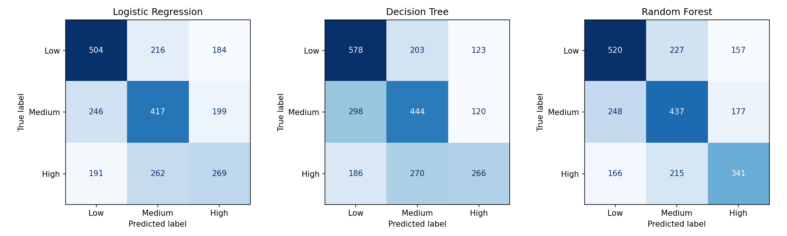
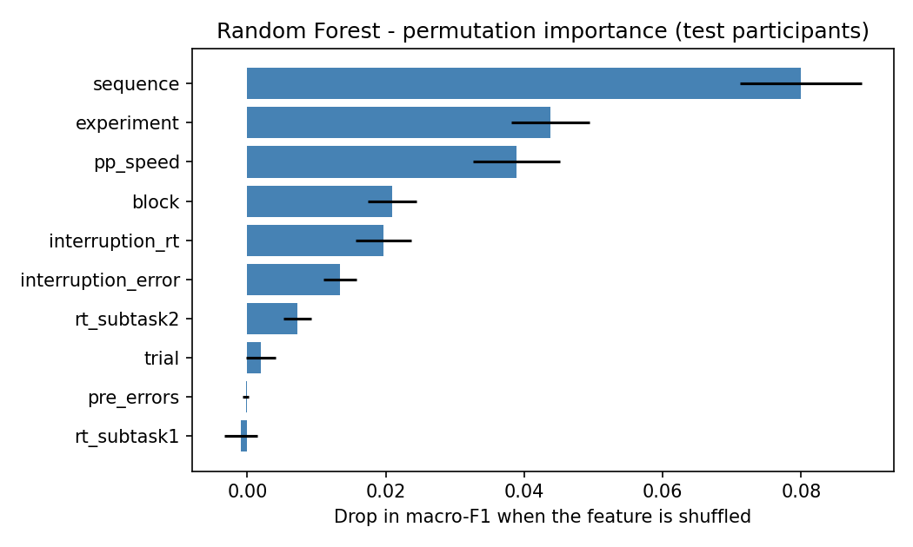

# C3 - Cognitive Checkpointing for Task Continuity

Component 3 of **Anchor AI** (J26-IT-366). Owner: [@sewmini001](https://github.com/sewmini001).
Status: **PP1 - Model 1 (resumption difficulty) trained and evaluated; backend (FastAPI + database) and browser
interface built and tested end to end; Model 2 (learned restart-summary model, Qwen2.5-1.5B + QLoRA) trained
and evaluated on synthetic data (results below); the human rating of its outputs and a pilot with real students are
still to do.**
Everything marked "planned" or "pending" below has not been done yet.

## 1. Problem

Working IT students are interrupted constantly (work shifts, messages, other courses). When they return to a
half-finished program or report, they lose time and make context errors while rebuilding what they were doing.

Evidence from the Hirsch et al. resumption-costs data (148 participants, 3 experiments; see
`notebooks/01_hirsch_exploration.ipynb`): the first step after an interruption is slower than the same step
without an interruption in every experiment (median +82 ms, +83 ms, +216 ms), and 73.6% of participants are
slower right after an interruption. The effect is small in the lab but consistent, and it is what C3 tries to
reduce for real study and coding tasks.

## 2. What C3 does and does not do

C3 lets the student save a short **checkpoint** at the moment of interruption (goal, completed work, current
working point, current problem or decision, next step, files/resources), predicts how hard resuming will be
(**Low / Medium / High**), and shows a **restart summary** on return. Every output can be **accepted, edited or
ignored**. Only text files are supported (code: `.html .css .js .py .java .php`; documents: `.docx .txt .md`);
files are read **read-only** to pre-fill the checkpoint.

**Boundary with C4:** C3 never generates task content (no new code, no assignment answers). It only summarises
the student's own progress and plan. Content assistance belongs to C4 (HCDE).

## 3. Objectives and status

Objective numbers follow the proposal. This project refines the scope (working IT students, text-file
pre-fill, restart-summary length) inside the original objectives; the changes are listed in the decision log
section below.

| # | Objective (short) | Status |
|---|-------------------|--------|
| 1 | Identify features associated with resumption difficulty (Hirsch, SWELL-KW as preliminary evidence) | **Hirsch done** (notebooks 01-04). SWELL-KW not yet explored (kept separate, never merged) |
| 2 | Structured checkpoint mechanism, triggered at interruption | **Built**: task board, checkpoint form with six fields, read-only file pre-fill (text, code and Word files), interruption trigger by drag-and-drop or notification, stored through the backend API |
| 3 | ML model predicting resumption difficulty and setting checkpoint depth | **Model 1 and Model 1b trained** (below). The application uses a transparent rule for difficulty and checkpoint depth; recalibration with pilot data planned |
| 4 | Personalised, editable restart summary | **Built with template summaries** (length depends on difficulty; Accept / Edit / Ignore). **Model 2** (Qwen2.5-1.5B, QLoRA): trained on a T4 GPU and evaluated on unseen synthetic task families (boundary checks pass; human rating pending) |
| 5 | Evaluation vs reminder and no-checkpoint (resumption time, context errors, NASA-TLX effort, SUS) | Study protocol planned; runs after PP1 |
| 6 | Collect a C3 interruption/checkpoint dataset | Study log stored in the database and exported as CSV (built); real data after the participant study |

## 4. Architecture

```
interruption starts (student action or notification)
      |
checkpoint capture  <-- file parser (text, code, .docx; read-only)        [built]
      |
difficulty (Low/Medium/High): transparent rule                            [built; Model 1 / 1b are the evidence for its direction]
      |
checkpoint depth + restart-summary length                                 [built]
      |
restart summary: template (default) or fine-tuned Qwen (Model 2)          [template built; Qwen adapter trained, synthetic-data evaluation done]
      |   safety net: the model answer is checked (own words, no advice, right depth,
      |   question kept); if a check fails the template is shown instead
Accept / Edit / Ignore  -->  interaction log in the database / CSV export [built]
```

**Backend** (`app/`): a FastAPI service that can run on its own or be mounted by the orchestration layer. It uses
the team's shared parts (`shared.db` SQLAlchemy base, `shared.auth` API key) and adds only `c3_` tables
(`c3_task`, `c3_checkpoint`, `c3_resumption`, `c3_event_log`): structured columns for the checkpoint fields,
prediction and Accept/Edit/Ignore events, and **JSONB** columns (JSON on SQLite) for the variable parts. Users are
pseudonymous codes (`X-User-Id`), never names or e-mails. Uploaded files are analysed read-only; only file names,
headings and open items are kept, never the file text.

| Route | Purpose |
|-------|---------|
| `GET /api/health` | status and available summary writers |
| `POST /api/predict` | difficulty and checkpoint depth with the reasons |
| `GET/POST /api/tasks`, `PATCH /api/tasks/{id}` | task board |
| `POST /api/tasks/{id}/checkpoint` | save a checkpoint (difficulty is decided on the server) |
| `GET /api/tasks/{id}/summary?mode=template` or `lora` | restart summary |
| `POST /api/tasks/{id}/resume` | Accept / Edit / Ignore, resumption log |
| `POST /api/files/analyze` | read-only analysis of text, code and `.docx` files |
| `GET /api/events`, `GET /api/export.csv` | study log |

Run it (from the repository root; SQLite needs no installation, with the team's PostgreSQL leave `DATABASE_URL` unset):

```bash
pip install -r requirements.txt -r components/c3_checkpointing/requirements.txt
DATABASE_URL=sqlite:///components/c3_checkpointing/c3_demo.db python -m uvicorn components.c3_checkpointing.app.main:app
```

PowerShell: set `$env:DATABASE_URL="sqlite:///components/c3_checkpointing/c3_demo.db"` first, then run the
`python -m uvicorn ...` command. Open `http://localhost:8000`. The header shows **Server** when the page is connected
to the backend.

**Interface** (`app/static/`, plain HTML, CSS and JavaScript, no build step): a **task board** with draggable cards,
a **checkpoint dialog** that predicts difficulty live and sets the checkpoint depth, **read-only file pre-fill**,
**live graphs** that move with every input (what adds to the difficulty score, and score against time away),
a **"Welcome back" popup** listing interrupted unfinished tasks, a **restart summary** with Accept / Edit / Ignore,
an **auto-log** that compares the student's files with a snapshot taken at the checkpoint (new functions, open items
done or added, line change), and a **study log** with CSV export and charts. Without the backend (opening `index.html` as a file) it still works and keeps
its data in the browser; the header then shows **Browser only**.

- Demo: press "Load demo data", then "I'm back"; or drag "Hotel booking website" to Interrupted and add
  `app/static/samples/contact.html` or `report_notes.docx` (Word files need the backend).
- **Auto-log (semi-automatic data):** the student still writes the parts only they know (problem, next step). The app
  collects the rest itself: time away, files and open items (read-only parsing), and on return what changed in the
  files since the checkpoint. Only names, headings, open-item texts and line counts are kept as a snapshot, never the
  file text. Fully automatic activity logging (IDE plugin, OS monitoring) is future work: it raises privacy issues and
  was outside the reduced scope.
- The difficulty comes from a transparent, hand-set rule (see "How it works" in the app), not from Model 1: the
  direction follows Model 1b, the thresholds are placeholders until pilot data.
- Tests: `node --test components/c3_checkpointing/tests/core.test.js` (28 tests) and
  `pytest components/c3_checkpointing` (79 tests): the difficulty rule and summary shared with the browser through
  common test vectors, the file parser including `.docx`, the API and database rules, Model 2 data and metrics, and a
  dry run of the LoRA training code on a tiny model.

## 5. Model 1 - resumption difficulty (trained)

**Unit and target.** Each row is one interrupted trial. Codebook facts (verified from `Codebook.pdf`): one data
row is one response; an interrupted trial runs subtask 1, subtask 2, interruption task, subtask 3, so subtask 3
is the resumption step. The target is the **resumption cost**: the reaction time of subtask 3 minus the same
participant's median in uninterrupted trials. Low / Medium / High are terciles of the cost (cut points -27 ms
and 266 ms, computed on training participants only). This is a **preliminary proxy label** from lab data.

**Data.** 14,208 interrupted trials -> 12,004 after cleaning (correct resumption step, reaction times between
200 ms and Q3 + 3 x IQR per experiment), from 147 participants.

**Evaluation.** Participants are split 117 train / 30 test with zero overlap; training participants are further
split into 5 folds. All models share the folds and the test participants. Hyperparameters and the final model are
chosen by cross-validation macro-F1; the test participants are used once. Chance level for three balanced
classes is about 0.33 macro-F1.

| Model | CV macro-F1 | Test accuracy | Test macro-F1 | Low<->High errors |
|-------|-------------|---------------|---------------|-------------------|
| Dummy (most frequent) | 0.158 | 0.363 | 0.178 | 29.0% |
| Logistic Regression | 0.512 +/- 0.020 | 0.478 | 0.471 | 15.1% |
| Decision Tree | 0.499 +/- 0.029 | 0.518 | 0.506 | 12.4% |
| **Random Forest** (chosen) | **0.518 +/- 0.025** | **0.522** | **0.519** | 13.0% |

The Random Forest beats Logistic Regression by only 0.006 in cross-validation, which is inside the fold-to-fold
spread, so the models are statistically close.





### Model 2 - restart summary (trained; synthetic-data evaluation done)

**Task.** From a checkpoint and its difficulty, write a short summary to the student that uses only the student's own
words, has the length of the difficulty (Low = two sentences, Medium = a paragraph, High = fuller with the open items as
a list), rewrites "I" as "you", and repeats a question as an open question without answering it.

**Data.** 552 **synthetic** examples (432 train, 48 validation, 72 test) generated by `model2/generate_data.py`
from 12 invented IT-student task families. Train, validation and test use *different families*, so the test measures
generalisation. The references restate the checkpoint by rule, so ROUGE-L against them is only a sanity check.

**Method.** Qwen2.5-1.5B-Instruct, QLoRA (4-bit NF4, LoRA r=16) with Hugging Face PEFT on a Colab T4 GPU; only the
answer tokens are trained on (`notebooks/06_model2_train_qlora.ipynb`). The adapter is kept in Google Drive.

**Evaluation** (`notebooks/07_model2_evaluation.ipynb`): the template, the base model and the fine-tuned model write
summaries for the 72 unseen test checkpoints (families the model never saw). Checks: *own words* (nothing that is not
in the checkpoint), *no advice or code*, *right depth*, *second person*, *question kept and not answered*, *length*.

**Results** (share of the 72 test summaries that pass, %; `outputs/model2_evaluation.png`):

| System | Own words | No advice | Right depth | Second person | Question kept | Length ok | ROUGE-L (sanity) |
|--------|-----------|-----------|-------------|---------------|---------------|-----------|------------------|
| Template (rule-based) | 100 | 100 | 100 | 79.2 | 100 | 100 | 0.646 |
| Base Qwen (not fine-tuned) | 0 | 59.7 | 0 | 59.7 | 27.8 | 50.0 | 0.306 |
| **Fine-tuned (Model 2)** | **100** | **100** | **97.2** | **100** | **100** | **100** | **0.862** |

Right depth by level for Model 2: Low 95.8, Medium 100, High 95.8. Validation loss per epoch:
0.081, 0.065, 0.058, 0.057, 0.057 (5 epochs, 17 min on a T4; `outputs/model2_training_loss.png`).

What this shows: the base model, given the same instructions, writes a chatty message ("Hi there ... Best, [Your Name]"),
gives advice ("You should try ...") and ignores the length rule. The fine-tuned model restates only the student's own
words, rewrites "I" as "you", repeats a question without answering it and follows the Low / Medium / High format.
That is the evidence for the C3-C4 boundary. The template is equally safe, but it copies "should i scale ..." in the
first person (79.2 % second person) and its layout is rigid.

**Iteration (v1 -> v2).** The first training run (3 epochs, no format line in the input) scored only 44.4 % on right
depth (Low 25, Medium 42, High 67): the model used the long format for every level. Adding an explicit `Summary format:`
line to the input and training 5 epochs raised it to 97.2 %. So the depth is partly *instruction following from the
format line*, not an independent judgement of difficulty; the difficulty itself comes from the rule (Section 4).

**Limits of this evidence.** The data are synthetic and the references come from the same generator, so the test
measures generalisation to new topics, not to real students' messy writing. ROUGE-L is only a sanity check. The
boundary checks are automatic rules (a regular-expression advice detector, word overlap); a blinded human rating of 18
pairs (base vs fine-tuned) is prepared (`human_rating_sheet.csv`) and **still has to be filled in**. In the application a
safety net checks every model answer and falls back to the template when a check fails.

## 6. Honest limitations

- **Lab data, not students.** The Hirsch interruption lasts about two seconds and the task is a colour/stimulus
  procedure. Student interruptions last hours and the tasks are coding and writing.
- **Only some features transfer.** Of the ten features, only interruption duration and a coarse task-complexity
  measure have a counterpart in a real application; the rest are lab reaction times or design variables
  (`sequence`, `experiment`, `block`). The Random Forest relies mostly on `sequence`, `experiment` and person
  speed. `notebooks/05_transferability_check.ipynb` measures this: with only the Objective 3 inputs
  (interruption duration, task complexity, prior interruptions) **Model 1b** reaches a macro-F1 of 0.41 in
  cross-validation and 0.43 on the test participants (chance 0.33); interruption duration alone is close to
  chance (0.35 with Logistic Regression, 0.39 with a Random Forest). Model 1b mostly misses the Medium class
  (recall 0.27) and makes Low<->High errors 20% of the time.
- **Prior interruptions point the "wrong" way for real life.** In the lab, more earlier interruptions mean a lower
  chance of a High cost (a practice effect within the session). This must not be assumed for students, where
  fatigue may work the other way.
- **Durations are on a different scale.** Lab interruptions last about 0.8-2.7 s; a model trained on them must not
  be fed minutes or hours without recalibration.
- **Interruption type** is not available in Hirsch, so the model cannot learn it.
- **The label is relative** (terciles), not an absolute definition of difficulty.
- The real feature set and labels will be collected in the participant study (Objective 6) and the model
  retrained.

## 7. Data and ethics

- Datasets are **never committed**: raw data (`data/raw/`), processed trial tables (`data/processed/`), tabular
  files (`*.csv`) and model weights are git-ignored.
- Hirsch et al. resumption-costs data comes from PsychArchives; place the three `raw-data_Exp*.csv` files and
  `Codebook.pdf` in `data/raw/hirsch/` (TODO: add the exact citation).
- SWELL-KW is evidence only and is never merged with Hirsch rows.
- Student files are parsed read-only and stay local; synthetic training data is clearly marked as synthetic.
- The main participant study will need ethics approval and informed consent (planned).

## 8. How to reproduce Model 1

Upload `data/raw/hirsch/*.csv` to `MyDrive/C3/data/raw/hirsch/` in Google Drive, then run in Colab (CPU), in order:

1. `notebooks/01_hirsch_exploration.ipynb` - understand the data and check that interruptions slow resumption.
2. `notebooks/02_hirsch_preprocessing.ipynb` - build the trial table, target, features, split and labels.
3. `notebooks/03_logistic_regression_baseline.ipynb` - baseline, cross-validation, ablation.
4. `notebooks/04_tree_models_comparison.ipynb` - Decision Tree, Random Forest, final model
   (`models/c3_difficulty_model.pkl`, git-ignored; kept in Drive).
5. `notebooks/05_transferability_check.ipynb` - how much signal remains with only inputs a real application can
   know, and Model 1b built from the Objective 3 inputs (`models/c3_difficulty_model_1b.pkl`, git-ignored).

Model 2 (Colab with a T4 GPU; upload `data/generated/*.jsonl` and `frame_vocab.json` to
`MyDrive/C3/data/generated/` first; regenerate them with `python -m components.c3_checkpointing.model2.generate_data`):

6. `notebooks/06_model2_train_qlora.ipynb` - fine-tune Qwen2.5-1.5B with QLoRA; the adapter goes to `MyDrive/C3/qwen_c3_lora`.
7. `notebooks/07_model2_evaluation.ipynb` - template vs base vs fine-tuned on the unseen test families, and the human rating sheet.

All random seeds are fixed (42). Plots are written to `MyDrive/C3/outputs/`.

## 9. Requirements (draft)

**Functional**

| ID | Requirement |
|----|-------------|
| FR1 | The student can start a checkpoint when beginning or being notified of an interruption |
| FR2 | The checkpoint captures goal, completed work, current working point, current problem or decision, next step, resources |
| FR3 | Quick questions can be skipped |
| FR4 | Text files (code and documents) are parsed read-only to pre-fill checkpoint fields |
| FR5 | The system predicts resumption difficulty (Low / Medium / High) from interruption duration, task complexity and interruption history |
| FR6 | Predicted difficulty sets the checkpoint depth and the restart-summary length |
| FR7 | The restart summary uses only the student's own checkpoint content and never produces new code or answers |
| FR8 | Every output can be accepted, edited or ignored |
| FR9 | Interactions (timestamps, resumption time, edits) are logged for the study and exportable without personal data |

**Non-functional**

| ID | Requirement |
|----|-------------|
| NFR1 | Privacy: files read-only, processed locally; no participant data or model weights in git |
| NFR2 | Explainability: the interface shows why a difficulty level was predicted |
| NFR3 | Responsiveness: a summary is shown within seconds on the prototype hardware |
| NFR4 | Modularity: the component is a REST API that does not edit `shared/` or other components |
| NFR5 | Reproducibility: fixed seeds, participant-wise splits, results regenerated by the notebooks |
| NFR6 | Usability target: SUS score reported in the evaluation (Objective 5) |

## 10. Risks and mitigation

| Risk | Mitigation |
|------|------------|
| Lab model does not transfer to students | State it as preliminary; build a deployable model on transferable features; retrain on pilot data |
| Low predictive power | Report against chance and a dummy model; use macro-F1; do not over-claim |
| Summary model invents code or answers (crosses into C4) | Train only on summary-style outputs, restrict prompts to the student's own checkpoint, review ~10% of synthetic data by hand |
| Student files contain private content | Read-only, local processing, no upload, explicit consent in the study |
| Colab GPU limits for fine-tuning | Small model (1.5B, 4-bit QLoRA), save adapters to Drive, fall back to template summaries |
| Too little time before PP1 | Prioritise: Model 1 (done) -> backend skeleton -> summary demo -> study protocol |
| Participant recruitment for the study | Plan recruitment early; small pilot first |

## 11. Potential and users (draft)

Target users: working university students in IT programmes, then junior developers and teams that lose time to
interruptions. Benefits: less time to resume, fewer context errors, lower perceived effort. Possible routes:
an editor or learning-platform plug-in for universities, offered as an institutional licence. Evidence for this
potential will come from the study measures (resumption time, SUS, NASA-TLX).

## 12. Decision log (scope refinements)

- Target users narrowed to working IT students.
- Added read-only text-file parsing to pre-fill checkpoints (not in the original objective wording).
- Difficulty now sets both checkpoint depth (Objective 3) and restart-summary length.
- "Current problem or decision" is kept as a quick question in the checkpoint (Objective 2).
- Model 1 target corrected after verifying the codebook: resumption cost of the first step after the interruption
  (earlier drafts mistakenly labelled every response).
- Model 2 uses Hugging Face PEFT/bitsandbytes (QLoRA) instead of Unsloth because its API is more stable; the learned
  summary is wrapped in a safety net and the template stays the default, so the application never shows an
  answer that fails the boundary checks.
- Model 2 is evaluated on the C3-C4 boundary (own words, no advice, depth, voice, question kept) and by blinded human
  rating, not only by ROUGE-L, because its references are synthetic.
- Database: PostgreSQL through the team's shared SQLAlchemy layer (not MongoDB, which an earlier draft assumed),
  with JSONB columns for the variable parts of a checkpoint. This matches `docker-compose.yml` and `shared/db.py`,
  needs no second database, and keeps study data exportable with SQL.
- Model 1b added: a model that uses only the Objective 3 inputs (interruption duration, task complexity, prior
  interruption history), reported next to the full lab model; it is the one intended for the application, after
  recalibration of durations.
- AI assistance: Claude Code was used for coding assistance; scope, evaluation design and interpretation decisions
  are the author's and are documented here.

## 13. Folder layout

- `CLAUDE.md` - rules and scope for Claude Code in this component.
- `notebooks/` - Colab notebooks 01-05 (Model 1 and Model 1b) and 06-07 (Model 2).
- `outputs/` - charts and evaluation figures.
- `data/` - `raw/`, `processed/` (git-ignored), `generated/` (synthetic `.jsonl`).
- `models/` - trained models (git-ignored).
- `app/` - FastAPI backend (`main.py`, `api.py`, `service.py`, `models.py`, `schemas.py`, `difficulty.py`, `summary.py`,
  `generators.py`) and `app/static/` (browser interface: `index.html`, `core.js`, `store.js`, `app.js`, `samples/`).
- `parser/` - read-only file analysis (text, code, `.docx`).
- `model2/` - synthetic data generator, evaluation metrics and LoRA training helpers for Model 2.
- `tests/` - Node and pytest tests (see above).
- `requirements.txt` - C3 extras on top of the team's requirements.
